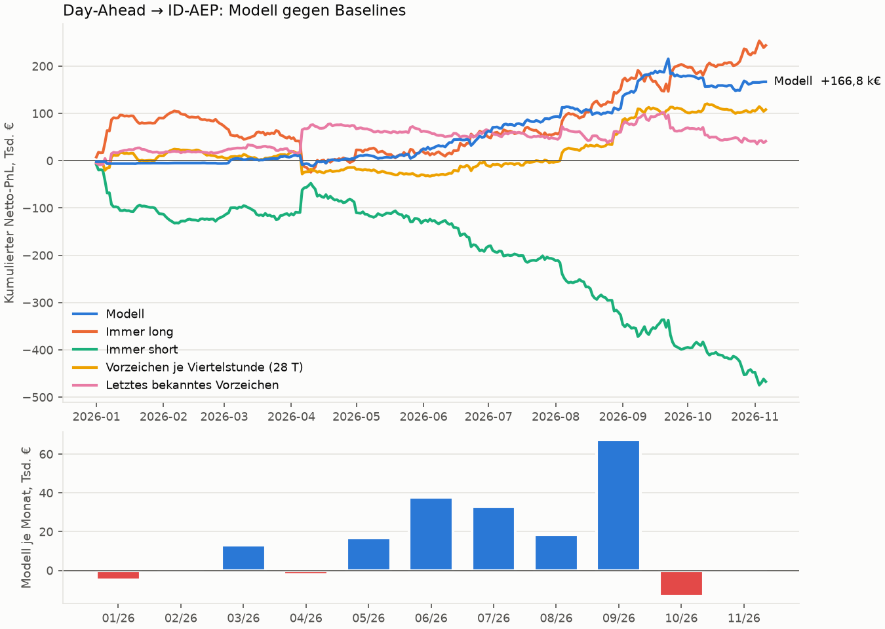

# Backtest-Report

Alle Zahlen im Detail. Die Kurzfassung steht im [README](../README.md).

Testzeitraum 2026-01-01 bis 2026-10-30 (303 Tage, walk-forward, jeder Monat out-of-sample). Position 10 MW je gehandelter Viertelstunde, Einstieg zum Day-Ahead-Preis, Ausstieg bewertet zum ID-AEP (Benchmark, kein handelbarer Preis). Kosten: 0,25 €/MWh je Seite, 1,0 €/MWh Slippage beim Ausstieg, 10 €/MWh Strafe, wenn der ID-AEP fehlt.

**Urteil nach dem vorab festgelegten Kriterium** (das Modell zählt nur, wenn es jede Baseline im Tages-PnL mit t > 2 schlägt): **nicht erfüllt**. Geschlagen: Immer short (t 3,13). Nicht geschlagen: Immer long (t -0,68), Vorzeichen je Viertelstunde (28 T) (t 0,29), Letztes bekanntes Vorzeichen (t 0,71).

- **Gewinnschwelle der Ausführung:** Das Modell verdient +3,05 €/MWh netto bei 1,0 €/MWh Slippage. Kostet der Ausstieg mehr als 4,0 €/MWh gegenüber dem ID-AEP, ist der Gewinn weg. Ob echte Ausführung das schafft, kann dieser Backtest nicht zeigen: Der ID-AEP ist ein Index, kein Preis, zu dem man handeln kann.
- **Long gegen Short:** long +149 219 € auf 26 848 MWh, short -23 874 € auf 14 288 MWh.
- **Spitzen:** ohne die 10 besten Tage bleiben -27 787 € von +125 345 €.

| Strategie | Netto € | €/MWh | MWh | Treffer | Sharpe (ann.) | t (HAC) | Max. Drawdown € | Schlechtester Tag € | ID-AEP fehlte |
|---|---:|---:|---:|---:|---:|---:|---:|---:|---:|
| **Modell** | +125 345 | +3,05 | 41 135 | 50 % | 1,61 | 1,49 | -64 957 | -38 827 | 0 |
| Immer long | +223 555 | +3,07 | 72 720 | 44 % | 2,09 | 1,60 | -129 624 | -48 138 | 0 |
| Immer short | -441 715 | -6,07 | 72 720 | 50 % | -4,13 | -3,16 | -452 611 | -30 949 | 0 |
| Vorzeichen je Viertelstunde (28 T) | +102 432 | +1,41 | 72 720 | 49 % | 1,41 | 1,21 | -57 401 | -44 370 | 0 |
| Letztes bekanntes Vorzeichen | +41 122 | +0,57 | 72 702 | 48 % | 0,51 | 0,47 | -63 001 | -27 745 | 0 |

**Modell minus Baseline**, Tages-PnL (t > 2: Vorsprung jenseits von Rauschen):

| gegen | Ø €/Tag | t (HAC) | Ø €/Tag, Spread gekappt ±200 | t |
|---|---:|---:|---:|---:|
| Immer long | -324,1 | -0,68 | +307,3 | 0,89 |
| Immer short | +1 871,5 | 3,13 | +1 253,8 | 3,70 |
| Vorzeichen je Viertelstunde (28 T) | +75,6 | 0,29 | +256,5 | 1,35 |
| Letztes bekanntes Vorzeichen | +278,0 | 0,71 | +531,6 | 2,68 |

**Spike-Abhängigkeit**: Netto-PnL in €, wenn der Spread auf ±X €/MWh begrenzt wäre (t in Klammern). Was unter der Kappung verschwindet, kam aus wenigen Preisspitzen.

| Strategie | ungekappt | davon 10 größte Viertelstunden | ohne die 10 besten Tage | ±500 | ±200 | ±100 |
|---|---:|---:|---:|---:|---:|---:|
| Modell | +125 345 | -9 550 | -27 787 | +140 284 (2,7) | +127 421 (2,8) | +94 776 (2,5) |
| Immer long | +223 555 | +33 512 | +483 | +121 385 (1,1) | +34 316 (0,4) | -54 402 (-0,7) |
| Immer short | -441 715 | -33 587 | -571 961 | -339 545 (-3,1) | -252 476 (-2,7) | -163 758 (-2,0) |
| Vorzeichen je Viertelstunde (28 T) | +102 432 | +33 512 | -42 145 | +56 742 (1,1) | +49 701 (1,1) | +28 160 (0,7) |
| Letztes bekanntes Vorzeichen | +41 122 | +44 228 | -140 478 | -13 587 (-0,3) | -33 668 (-0,8) | -44 506 (-1,2) |

**Kostenempfindlichkeit**: Netto-PnL in € bei Slippage (€/MWh gegenüber dem ID-AEP) von

| Strategie | 0,0 | 1,0 | 2,0 | 5,0 | Gewinnschwelle €/MWh |
|---|---:|---:|---:|---:|---:|
| Modell | +166 480 | +125 345 | +84 210 | -39 195 | 4,0 |
| Immer long | +296 275 | +223 555 | +150 835 | -67 325 | 4,1 |
| Immer short | -368 995 | -441 715 | -514 435 | -732 595 | – (verliert schon ohne Slippage) |
| Vorzeichen je Viertelstunde (28 T) | +175 152 | +102 432 | +29 712 | -188 448 | 2,4 |
| Letztes bekanntes Vorzeichen | +113 825 | +41 122 | -31 580 | -249 688 | 1,6 |

**Long- und Short-Seite** (netto €, in Klammern MWh)

| Strategie | long | short |
|---|---:|---:|
| Modell | +149 219 (26 848) | -23 874 (14 288) |
| Immer long | +223 555 (72 720) | +0 (0) |
| Immer short | +0 (0) | -441 715 (72 720) |
| Vorzeichen je Viertelstunde (28 T) | +205 882 (44 128) | -103 450 (28 592) |
| Letztes bekanntes Vorzeichen | +189 946 (34 425) | -148 824 (38 278) |

**Modell je Monat**

| Monat | Netto € | MWh | Schwelle €/MWh | Trainingstage |
|---|---:|---:|---:|---:|
| 2026-01 | -4 985 | 130 | 30 | 90 |
| 2026-02 | -1 051 | 110 | 30 | 121 |
| 2026-03 | +10 586 | 1 055 | 20 | 149 |
| 2026-04 | -27 226 | 4 842 | 5 | 180 |
| 2026-05 | +18 559 | 3 850 | 10 | 210 |
| 2026-06 | +33 691 | 5 338 | 5 | 241 |
| 2026-07 | +34 647 | 6 592 | 2 | 271 |
| 2026-08 | +9 647 | 6 555 | 2 | 302 |
| 2026-09 | +65 951 | 6 175 | 2 | 333 |
| 2026-10 | -14 474 | 6 488 | 2 | 363 |

### Robustheit: alle getesteten Varianten

Gleicher Walk-forward, gleiche Kosten. Vor dem ersten Backtest auf echten Daten stand nur die erste Version fest (erste Zeile). Danach wurde das Hauptmodell dreimal geändert: Lastprognose entfernt (Zeitstempel nicht belegbar), Mittel aus fünf Startwerten (ein Einzel-Fit hing stark am Startwert), Handelsschwelle nie unter den Round-trip-Kosten. Keine der Änderungen hat den PnL im Test gesenkt. Alle anderen Varianten kamen danach, und alle stehen hier, auch die schlechten. Die beste Zeile zur Strategie zu erklären wäre Anpassung an den Testzeitraum: Die Tabelle zeigt, wie unsicher die Hauptzahl ist.

| Variante | Netto € | €/MWh | t | Spread gekappt ±200: Netto € (t) | t gegen Vorzeichen je Viertelstunde | Long € | Short € |
|---|---:|---:|---:|---:|---:|---:|---:|
| _Hauptmodell_ | | | | | | | |
| **erste Version, vor dem ersten Backtest festgelegt (mit Lastprognose, ein einzelnes Modell, Startwert 0, Schwelle 0 erlaubt)** | +117 590 | +2,84 | 1,45 | +138 748 (3,2) | 0,18 | +126 414 | -8 823 |
| **Hauptmodell: ohne Lastprognose, Mittel aus fünf Startwerten, Schwelle mindestens 2 €/MWh** | +125 345 | +3,05 | 1,49 | +127 421 (2,8) | 0,29 | +149 219 | -23 874 |
| _Datenstand_ | | | | | | | |
| mit Lastprognose | +122 929 | +3,37 | 1,54 | +140 069 (3,0) | 0,23 | +140 487 | -17 558 |
| Wetter nur so frisch wie im Archiv (vollständige Läufe auf dessen Vorlaufzeiten 24–29 h und 48–53 h zurückgeschnitten) | +116 673 | +2,89 | 1,68 | +96 599 (2,5) | 0,16 | +188 685 | -72 012 |
| ohne MW-Features (keine installierte Leistung) | +182 430 | +4,71 | 2,43 | +128 773 (2,9) | 1,09 | +175 402 | +7 028 |
| _Entscheidungsregel_ | | | | | | | |
| Schwelle 0 erlaubt (Regel bis 9. Oktober 2026) | +122 800 | +2,81 | 1,44 | +124 560 (2,7) | 0,26 | +157 162 | -34 362 |
| feste Schwelle 2 €/MWh, nichts gewählt | +17 843 | +0,28 | 0,15 | +65 191 (0,9) | -0,74 | +143 292 | -125 449 |
| Schwelle auf 56 statt 28 Tagen gewählt | +111 165 | +3,16 | 1,35 | +130 985 (2,9) | 0,10 | +118 860 | -7 695 |
| Schwelle auf allen bisherigen Out-of-sample-Tagen gewählt | +97 105 | +8,09 | 1,84 | +77 187 (3,2) | -0,06 | +95 068 | +2 036 |
| getrennte Schwellen für long und short, „nie“ erlaubt | +100 267 | +2,49 | 1,32 | +96 034 (2,1) | -0,03 | +123 691 | -23 424 |
| Größe nach Signalstärke (10–20 MW) | +249 059 | +3,25 | 1,54 | +249 938 (2,9) | 1,08 | +292 036 | -42 977 |
| _Modell_ | | | | | | | |
| Median- statt Quadratverlust | -31 363 | -1,12 | -0,57 | +47 885 (1,3) | -1,28 | +40 093 | -71 456 |
| stärker reguliert (150 Bäume, ≥ 500 Viertelstunden je Blatt) | +99 568 | +2,68 | 1,52 | +122 009 (3,0) | -0,03 | +170 443 | -70 875 |
| Trainingsziel hart auf ±100 €/MWh gekappt | +88 581 | +2,13 | 1,02 | +131 147 (3,0) | -0,16 | +98 766 | -10 185 |
| Mittel aus 5 Modellen auf Tages-Bootstraps | +145 470 | +4,13 | 1,80 | +151 065 (3,9) | 0,58 | +149 633 | -4 163 |
| zweistufig: ÜNB-Prognosefehler vorhersagen, dann in € umrechnen | +45 083 | +2,21 | 0,64 | +50 391 (1,2) | -0,72 | +54 970 | -9 887 |
| _Feature-Gruppe weggelassen_ | | | | | | | |
| ohne Wetter | -67 796 | -3,07 | -1,13 | +25 675 (0,9) | -1,88 | -10 478 | -57 318 |
| ohne Spread-Historie | +144 527 | +3,21 | 1,73 | +141 405 (3,3) | 0,55 | +176 566 | -32 039 |
| ohne Day-Ahead-Preise des Vortags | +159 742 | +4,55 | 2,44 | +105 814 (2,8) | 0,71 | +179 006 | -19 265 |
| _Startmonat_ | | | | | | | |
| Test ab Dezember 2025 (59 statt 60 Trainingstage verlangt) (2025-12-01 bis 2026-10-30) | +102 413 | +2,28 | 1,19 | +108 748 (2,3) | 0,26 | +139 343 | -36 930 |
| _Zufallsstartwert_ | | | | | | | |
| ein einzelnes Modell statt des Mittels, Startwert 0 | +141 325 | +3,98 | 2,02 | +119 737 (3,0) | 0,44 | +167 383 | -26 058 |
| ein einzelnes Modell statt des Mittels, Startwert 1 | +129 643 | +3,12 | 1,55 | +119 496 (2,8) | 0,34 | +163 099 | -33 456 |
| ein einzelnes Modell statt des Mittels, Startwert 2 | +136 680 | +3,14 | 1,64 | +130 470 (2,8) | 0,40 | +173 353 | -36 673 |
| ein einzelnes Modell statt des Mittels, Startwert 3 | +149 628 | +3,92 | 2,22 | +149 078 (3,5) | 0,59 | +144 336 | +5 292 |
| ein einzelnes Modell statt des Mittels, Startwert 4 | +99 906 | +2,77 | 1,18 | +142 495 (3,5) | -0,03 | +120 092 | -20 186 |
| Mittel über die Startwerte 5–9 | +126 394 | +3,02 | 1,53 | +147 427 (3,4) | 0,30 | +124 512 | +1 882 |
| Mittel über die Startwerte 10–14 | +175 421 | +4,52 | 2,33 | +168 312 (3,9) | 0,92 | +176 535 | -1 114 |

Spanne über die Varianten (ohne weggelassene Feature-Gruppen und ohne die größere Position): -31 363 bis +182 430 €.
Ein einzelnes Modell landet je nach Zufallsstartwert bei +99 906 bis +149 628 € (t 1,18 bis 2,22). So groß ist das Schätzrauschen, bevor irgendeine Designentscheidung ins Spiel kommt; deshalb mittelt das Hauptmodell fünf Startwerte.
Mittel über fünf Startwerte: 0–4 (Hauptmodell): +125 345 € (t 1,49), 5–9: +126 394 € (t 1,53), 10–14: +175 421 € (t 2,33).

### Was ein Prognosefehler kostet (ex post)

| Fehler (Ist − ÜNB-DA), je GW | €/MWh Spread | t | gekappt ±200 | t | 00-06 | 06-10 | 10-16 | 16-20 | 20-24 |
|---|---:|---:|---:|---:|---:|---:|---:|---:|---:|
| Konstante | +4,83 | 3,5 | +2,36 | 2,8 | +4,85 | +4,83 | +9,17 | +2,17 | +9,91 |
| Solar | -8,15 | -6,4 | -7,90 | -13,6 | – | -11,37 | -7,94 | -7,77 | – |
| Wind an Land | -3,97 | -1,8 | -5,01 | -6,3 | -6,08 | -6,70 | +4,29 | -7,45 | -11,23 |
| Wind auf See | -6,10 | -2,4 | -5,04 | -4,3 | -9,47 | -8,86 | -2,91 | -10,38 | -8,44 |
| Last | +0,72 | 1,2 | -0,02 | -0,1 | -0,35 | -0,88 | +1,45 | +2,40 | -0,63 |

n = 37 924 Viertelstunden, R² = 0,03, gekappt 0,12. t mit Newey-West-Standardfehlern (Lags: ein Tag). „Gekappt“: Spread auf ±200 €/MWh begrenzt, damit wenige Preisspitzen die Schätzung nicht dominieren. Spalten rechts: getrennte Regressionen je Tageszeit (ungekappt); „–“: Fehler schwankt dort zu wenig (Standardabweichung unter 250 MW) für eine sinnvolle Steigung.

### Stimmen die Zeitstempel der Wetterdaten?

Der Lookahead-Test prüft, dass der Code jedes `available_at` respektiert. Ob die Stempel selbst stimmen, lässt sich prüfen, wo das Dataset beide Arten von Prognosen hat: Archivwerte („Tag 1“ = mindestens 24 h alt, „Tag 2“ = 48 h) und vollständige Läufe (nachgeladen oder live mitgeschnitten).

| Wettermodell | Gültigkeitszeiten | Archivwert | Werte geprüft | genau einem Lauf zuzuordnen | Vorlauf dieses Laufs (min / Median / max) | frischer als behauptet |
|---|---|---|---:|---:|---:|---:|
| icon_eu | 2026-04-05 bis 2026-09-30 | Tag 1 (behauptet ≥ 24 h) | 68 736 | 67 692 | 24 / 27 / 29 h | 0 |
| icon_eu | 2026-04-05 bis 2026-09-30 | Tag 2 (behauptet ≥ 48 h) | 68 736 | 66 137 | 48 / 50 / 53 h | 0 |
| ecmwf_ifs | 2025-10-01 bis 2026-09-30 | Tag 1 (behauptet ≥ 24 h) | 140 160 | 111 300 | 24 / 27 / 71 h | 0 |
| ecmwf_ifs | 2025-10-01 bis 2026-09-30 | Tag 2 (behauptet ≥ 48 h) | 140 160 | 107 729 | 29 / 51 / 71 h | 1 |

Ein Archivwert gilt als zugeordnet, wenn er in allen Variablen, die beide Datenarten haben, exakt einem einzigen vollständigen Lauf gleicht. „Frischer als behauptet“ zählt Werte aus einem Lauf mit kürzerem Vorlauf als angegeben. Verglichen wird fast nur mit nachgeladenen Läufen, denn das Archiv endet, kurz nachdem der Live-Mitschnitt beginnt. Die live mitgeschnittenen Läufe liefern dafür die gemessene Veröffentlichungszeit.
Gemessen: icon_eu 2,9 bis 4,3 h nach Laufstart (256 Läufe; das Archiv setzt 4,5 h an); ecmwf_ifs 6,0 bis 8,2 h nach Laufstart (130 Läufe; das Archiv setzt 8,5 h an).

Gerechnet am 2026-11-01 06:05 UTC, Code a032768, Wetterdaten akderekaan/de-power-forecast-data @ eaa63f837e83.
