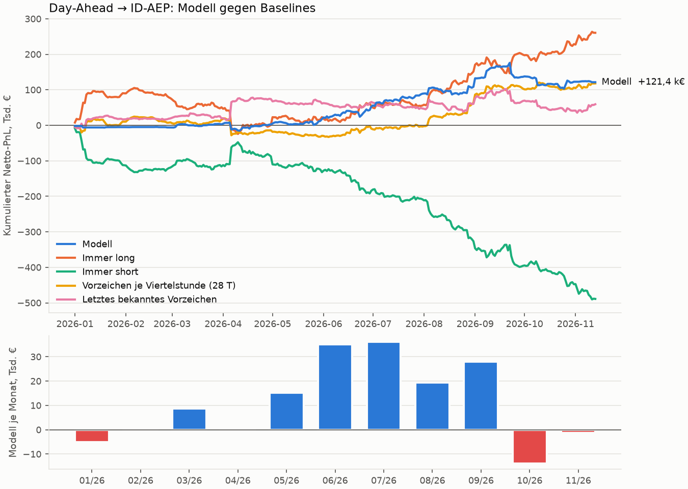

# Backtest-Report

Alle Zahlen im Detail. Die Kurzfassung steht im [README](../README.md).

Testzeitraum 2026-01-01 bis 2026-11-13 (317 Tage, walk-forward, jeder Monat out-of-sample). Position 10 MW je gehandelter Viertelstunde, Einstieg zum Day-Ahead-Preis, Ausstieg bewertet zum ID-AEP (Benchmark, kein handelbarer Preis). Kosten: 0,25 €/MWh je Seite, 1,0 €/MWh Slippage beim Ausstieg, 10 €/MWh Strafe, wenn der ID-AEP fehlt.

**Urteil nach dem vorab festgelegten Kriterium** (das Modell zählt nur, wenn es jede Baseline im Tages-PnL mit t > 2 schlägt): **nicht erfüllt**. Geschlagen: Immer short (t 3,68). Nicht geschlagen: Immer long (t -0,90), Vorzeichen je Viertelstunde (28 T) (t 0,04), Letztes bekanntes Vorzeichen (t 0,62).

- **Gewinnschwelle der Ausführung:** Das Modell verdient +3,50 €/MWh netto bei 1,0 €/MWh Slippage. Kostet der Ausstieg mehr als 4,5 €/MWh gegenüber dem ID-AEP, ist der Gewinn weg. Ob echte Ausführung das schafft, kann dieser Backtest nicht zeigen: Der ID-AEP ist ein Index, kein Preis, zu dem man handeln kann.
- **Long gegen Short:** long +152 236 € auf 23 198 MWh, short -30 786 € auf 11 518 MWh.
- **Spitzen:** ohne die 10 besten Tage bleiben -15 232 € von +121 450 €.

| Strategie | Netto € | €/MWh | MWh | Treffer | Sharpe (ann.) | t (HAC) | Max. Drawdown € | Schlechtester Tag € | ID-AEP fehlte |
|---|---:|---:|---:|---:|---:|---:|---:|---:|---:|
| **Modell** | +121 450 | +3,50 | 34 715 | 50 % | 1,77 | 1,61 | -72 617 | -30 602 | 0 |
| Immer long | +260 590 | +3,43 | 76 080 | 45 % | 2,33 | 1,85 | -129 624 | -48 138 | 0 |
| Immer short | -488 830 | -6,43 | 76 080 | 50 % | -4,37 | -3,47 | -490 198 | -30 949 | 0 |
| Vorzeichen je Viertelstunde (28 T) | +118 103 | +1,55 | 76 080 | 49 % | 1,56 | 1,39 | -57 401 | -44 370 | 0 |
| Letztes bekanntes Vorzeichen | +59 331 | +0,78 | 76 062 | 49 % | 0,71 | 0,67 | -66 427 | -27 745 | 0 |

**Modell minus Baseline**, Tages-PnL (t > 2: Vorsprung jenseits von Rauschen):

| gegen | Ø €/Tag | t (HAC) | Ø €/Tag, Spread gekappt ±200 | t |
|---|---:|---:|---:|---:|
| Immer long | -438,9 | -0,90 | +169,4 | 0,51 |
| Immer short | +1 925,2 | 3,68 | +1 307,3 | 4,08 |
| Vorzeichen je Viertelstunde (28 T) | +10,6 | 0,04 | +183,6 | 1,02 |
| Letztes bekanntes Vorzeichen | +196,0 | 0,62 | +434,0 | 2,32 |

**Spike-Abhängigkeit**: Netto-PnL in €, wenn der Spread auf ±X €/MWh begrenzt wäre (t in Klammern). Was unter der Kappung verschwindet, kam aus wenigen Preisspitzen.

| Strategie | ungekappt | davon 10 größte Viertelstunden | ohne die 10 besten Tage | ±500 | ±200 | ±100 |
|---|---:|---:|---:|---:|---:|---:|
| Modell | +121 450 | -8 519 | -15 232 | +129 670 (2,7) | +119 939 (2,9) | +95 250 (2,6) |
| Immer long | +260 590 | +33 512 | +37 519 | +158 421 (1,4) | +66 250 (0,7) | -32 620 (-0,4) |
| Immer short | -488 830 | -33 587 | -619 342 | -386 661 (-3,5) | -294 490 (-3,1) | -195 620 (-2,4) |
| Vorzeichen je Viertelstunde (28 T) | +118 103 | +33 512 | -29 716 | +72 413 (1,4) | +61 727 (1,4) | +35 986 (0,9) |
| Letztes bekanntes Vorzeichen | +59 331 | +44 228 | -127 495 | +4 622 (0,1) | -17 637 (-0,4) | -31 568 (-0,8) |

**Kostenempfindlichkeit**: Netto-PnL in € bei Slippage (€/MWh gegenüber dem ID-AEP) von

| Strategie | 0,0 | 1,0 | 2,0 | 5,0 | Gewinnschwelle €/MWh |
|---|---:|---:|---:|---:|---:|
| Modell | +156 165 | +121 450 | +86 735 | -17 410 | 4,5 |
| Immer long | +336 670 | +260 590 | +184 510 | -43 730 | 4,4 |
| Immer short | -412 750 | -488 830 | -564 910 | -793 150 | – (verliert schon ohne Slippage) |
| Vorzeichen je Viertelstunde (28 T) | +194 183 | +118 103 | +42 023 | -186 217 | 2,5 |
| Letztes bekanntes Vorzeichen | +135 393 | +59 331 | -16 732 | -244 919 | 1,8 |

**Long- und Short-Seite** (netto €, in Klammern MWh)

| Strategie | long | short |
|---|---:|---:|
| Modell | +152 236 (23 198) | -30 786 (11 518) |
| Immer long | +260 590 (76 080) | +0 (0) |
| Immer short | +0 (0) | -488 830 (76 080) |
| Vorzeichen je Viertelstunde (28 T) | +233 128 (46 892) | -115 025 (29 188) |
| Letztes bekanntes Vorzeichen | +220 096 (36 100) | -160 765 (39 962) |

**Modell je Monat**

| Monat | Netto € | MWh | Schwelle €/MWh | Trainingstage |
|---|---:|---:|---:|---:|
| 2026-01 | -4 988 | 128 | 30 | 90 |
| 2026-02 | -970 | 125 | 30 | 121 |
| 2026-03 | +8 782 | 1 078 | 20 | 149 |
| 2026-04 | -178 | 2 798 | 10 | 180 |
| 2026-05 | +15 152 | 3 820 | 10 | 210 |
| 2026-06 | +35 062 | 6 442 | 2 | 241 |
| 2026-07 | +36 212 | 6 585 | 2 | 271 |
| 2026-08 | +19 435 | 5 170 | 5 | 302 |
| 2026-09 | +28 018 | 1 578 | 15 | 333 |
| 2026-10 | -13 780 | 6 742 | 2 | 363 |
| 2026-11 | -1 296 | 250 | 30 | 394 |

### Robustheit: alle getesteten Varianten

Gleicher Walk-forward, gleiche Kosten. Vor dem ersten Backtest auf echten Daten stand nur die erste Version fest (erste Zeile). Danach wurde das Hauptmodell dreimal geändert: Lastprognose entfernt (Zeitstempel nicht belegbar), Mittel aus fünf Startwerten (ein Einzel-Fit hing stark am Startwert), Handelsschwelle nie unter den Round-trip-Kosten. Keine der Änderungen hat den PnL im Test gesenkt. Alle anderen Varianten kamen danach, und alle stehen hier, auch die schlechten. Die beste Zeile zur Strategie zu erklären wäre Anpassung an den Testzeitraum: Die Tabelle zeigt, wie unsicher die Hauptzahl ist.

| Variante | Netto € | €/MWh | t | Spread gekappt ±200: Netto € (t) | t gegen Vorzeichen je Viertelstunde | Long € | Short € |
|---|---:|---:|---:|---:|---:|---:|---:|
| _Hauptmodell_ | | | | | | | |
| **erste Version, vor dem ersten Backtest festgelegt (mit Lastprognose, ein einzelnes Modell, Startwert 0, Schwelle 0 erlaubt)** | +153 345 | +3,91 | 2,18 | +138 395 (3,2) | 0,37 | +140 771 | +12 574 |
| **Hauptmodell: ohne Lastprognose, Mittel aus fünf Startwerten, Schwelle mindestens 2 €/MWh** | +121 450 | +3,50 | 1,61 | +119 939 (2,9) | 0,04 | +152 236 | -30 786 |
| _Datenstand_ | | | | | | | |
| mit Lastprognose | +159 949 | +3,81 | 2,27 | +156 659 (3,4) | 0,49 | +157 902 | +2 047 |
| Wetter nur so frisch wie im Archiv (vollständige Läufe auf dessen Vorlaufzeiten 24–29 h und 48–53 h zurückgeschnitten) | +94 582 | +2,50 | 1,44 | +92 609 (2,5) | -0,26 | +158 290 | -63 708 |
| ohne MW-Features (keine installierte Leistung) | +182 741 | +4,66 | 2,43 | +130 444 (2,9) | 0,87 | +178 435 | +4 306 |
| _Entscheidungsregel_ | | | | | | | |
| Schwelle 0 erlaubt (Regel bis 9. Oktober 2026) | +115 535 | +3,18 | 1,53 | +117 269 (2,8) | -0,03 | +154 239 | -38 703 |
| feste Schwelle 2 €/MWh, nichts gewählt | +15 492 | +0,23 | 0,13 | +65 163 (0,9) | -0,88 | +154 758 | -139 267 |
| Schwelle auf 56 statt 28 Tagen gewählt | +96 116 | +2,34 | 1,08 | +107 772 (2,1) | -0,25 | +148 722 | -52 606 |
| Schwelle auf allen bisherigen Out-of-sample-Tagen gewählt | +66 340 | +5,31 | 1,20 | +51 148 (1,9) | -0,59 | +88 902 | -22 563 |
| getrennte Schwellen für long und short, „nie“ erlaubt | +146 904 | +3,69 | 2,07 | +111 660 (2,5) | 0,39 | +171 718 | -24 814 |
| Größe nach Signalstärke (10–20 MW) | +180 485 | +2,51 | 1,19 | +231 837 (2,9) | 0,46 | +239 634 | -59 149 |
| _Modell_ | | | | | | | |
| Median- statt Quadratverlust | -27 343 | -0,87 | -0,48 | +54 618 (1,4) | -1,41 | +65 059 | -92 401 |
| stärker reguliert (150 Bäume, ≥ 500 Viertelstunden je Blatt) | +105 237 | +2,68 | 1,52 | +119 584 (2,8) | -0,14 | +168 698 | -63 461 |
| Trainingsziel hart auf ±100 €/MWh gekappt | +87 215 | +2,16 | 1,04 | +100 841 (2,3) | -0,39 | +107 140 | -19 925 |
| Mittel aus 5 Modellen auf Tages-Bootstraps | +90 301 | +2,25 | 1,02 | +119 291 (2,7) | -0,34 | +132 432 | -42 131 |
| zweistufig: ÜNB-Prognosefehler vorhersagen, dann in € umrechnen | +32 095 | +1,57 | 0,47 | +47 092 (1,1) | -1,05 | +36 867 | -4 772 |
| _Feature-Gruppe weggelassen_ | | | | | | | |
| ohne Wetter | -65 617 | -2,92 | -1,09 | +27 941 (1,0) | -2,02 | -10 006 | -55 612 |
| ohne Spread-Historie | +118 139 | +2,52 | 1,47 | +116 603 (2,5) | 0,00 | +171 692 | -53 554 |
| ohne Day-Ahead-Preise des Vortags | +144 350 | +3,75 | 2,01 | +107 963 (2,8) | 0,38 | +171 918 | -27 568 |
| _Startmonat_ | | | | | | | |
| Test ab Dezember 2025 (59 statt 60 Trainingstage verlangt) (2025-12-01 bis 2026-11-13) | +99 750 | +2,59 | 1,29 | +102 497 (2,3) | 0,03 | +143 402 | -43 652 |
| _Zufallsstartwert_ | | | | | | | |
| ein einzelnes Modell statt des Mittels, Startwert 0 | +143 630 | +4,03 | 1,97 | +113 818 (2,9) | 0,29 | +189 193 | -45 563 |
| ein einzelnes Modell statt des Mittels, Startwert 1 | +63 547 | +1,78 | 0,77 | +94 391 (2,4) | -0,64 | +120 304 | -56 757 |
| ein einzelnes Modell statt des Mittels, Startwert 2 | +63 500 | +1,49 | 0,90 | +69 282 (1,5) | -0,53 | +154 404 | -90 904 |
| ein einzelnes Modell statt des Mittels, Startwert 3 | +178 056 | +4,30 | 2,39 | +149 450 (3,2) | 0,77 | +184 493 | -6 437 |
| ein einzelnes Modell statt des Mittels, Startwert 4 | +65 306 | +1,91 | 0,90 | +104 086 (2,7) | -0,64 | +103 914 | -38 608 |
| Mittel über die Startwerte 5–9 | +129 288 | +3,22 | 1,47 | +138 426 (3,0) | 0,14 | +137 126 | -7 838 |
| Mittel über die Startwerte 10–14 | +154 202 | +4,10 | 1,99 | +163 585 (3,8) | 0,48 | +127 841 | +26 361 |

Spanne über die Varianten (ohne weggelassene Feature-Gruppen und ohne die größere Position): -27 343 bis +182 741 €.
Ein einzelnes Modell landet je nach Zufallsstartwert bei +63 500 bis +178 056 € (t 0,77 bis 2,39). So groß ist das Schätzrauschen, bevor irgendeine Designentscheidung ins Spiel kommt; deshalb mittelt das Hauptmodell fünf Startwerte.
Mittel über fünf Startwerte: 0–4 (Hauptmodell): +121 450 € (t 1,61), 5–9: +129 288 € (t 1,47), 10–14: +154 202 € (t 1,99).

### Was ein Prognosefehler kostet (ex post)

| Fehler (Ist − ÜNB-DA), je GW | €/MWh Spread | t | gekappt ±200 | t | 00-06 | 06-10 | 10-16 | 16-20 | 20-24 |
|---|---:|---:|---:|---:|---:|---:|---:|---:|---:|
| Konstante | +5,08 | 3,7 | +2,69 | 3,2 | +4,90 | +5,00 | +9,46 | +2,50 | +10,17 |
| Solar | -8,42 | -6,7 | -8,17 | -14,0 | – | -11,66 | -8,15 | -7,70 | – |
| Wind an Land | -4,08 | -1,9 | -5,10 | -6,4 | -6,14 | -6,78 | +4,08 | -7,67 | -11,28 |
| Wind auf See | -6,50 | -2,6 | -5,43 | -4,7 | -9,47 | -8,94 | -3,22 | -10,93 | -8,74 |
| Last | +0,85 | 1,4 | +0,15 | 0,5 | -0,43 | -0,84 | +1,60 | +2,66 | -0,52 |

n = 39 364 Viertelstunden, R² = 0,03, gekappt 0,12. t mit Newey-West-Standardfehlern (Lags: ein Tag). „Gekappt“: Spread auf ±200 €/MWh begrenzt, damit wenige Preisspitzen die Schätzung nicht dominieren. Spalten rechts: getrennte Regressionen je Tageszeit (ungekappt); „–“: Fehler schwankt dort zu wenig (Standardabweichung unter 250 MW) für eine sinnvolle Steigung.

### Stimmen die Zeitstempel der Wetterdaten?

Der Lookahead-Test prüft, dass der Code jedes `available_at` respektiert. Ob die Stempel selbst stimmen, lässt sich prüfen, wo das Dataset beide Arten von Prognosen hat: Archivwerte („Tag 1“ = mindestens 24 h alt, „Tag 2“ = 48 h) und vollständige Läufe (nachgeladen oder live mitgeschnitten).

| Wettermodell | Gültigkeitszeiten | Archivwert | Werte geprüft | genau einem Lauf zuzuordnen | Vorlauf dieses Laufs (min / Median / max) | frischer als behauptet |
|---|---|---|---:|---:|---:|---:|
| icon_eu | 2026-04-05 bis 2026-10-31 | Tag 1 (behauptet ≥ 24 h) | 80 640 | 79 272 | 24 / 27 / 33 h | 0 |
| icon_eu | 2026-04-05 bis 2026-10-31 | Tag 2 (behauptet ≥ 48 h) | 80 640 | 66 706 | 45 / 50 / 53 h | 140 |
| ecmwf_ifs | 2025-10-01 bis 2026-10-31 | Tag 1 (behauptet ≥ 24 h) | 152 064 | 120 739 | 18 / 27 / 71 h | 6 |
| ecmwf_ifs | 2025-10-01 bis 2026-10-31 | Tag 2 (behauptet ≥ 48 h) | 152 064 | 117 259 | 29 / 51 / 71 h | 7 |

Ein Archivwert gilt als zugeordnet, wenn er in allen Variablen, die beide Datenarten haben, exakt einem einzigen vollständigen Lauf gleicht. „Frischer als behauptet“ zählt Werte aus einem Lauf mit kürzerem Vorlauf als angegeben. Verglichen wird fast nur mit nachgeladenen Läufen, denn das Archiv endet, kurz nachdem der Live-Mitschnitt beginnt. Die live mitgeschnittenen Läufe liefern dafür die gemessene Veröffentlichungszeit.
Gemessen: icon_eu 2,9 bis 4,3 h nach Laufstart (368 Läufe; das Archiv setzt 4,5 h an); ecmwf_ifs 6,0 bis 8,2 h nach Laufstart (186 Läufe; das Archiv setzt 8,5 h an).

Gerechnet am 2026-11-15 06:04 UTC, Code 21c133b, Wetterdaten akderekaan/de-power-forecast-data @ d08143f0485e.
