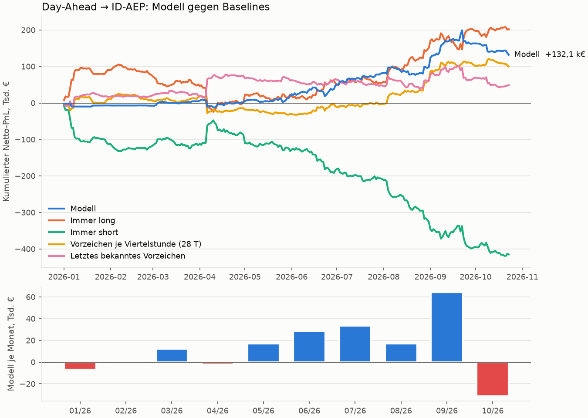

# Backtest-Report

Alle Zahlen im Detail. Die Kurzfassung steht im [README](../README.md).

Testzeitraum 2026-01-01 bis 2026-10-23 (296 Tage, walk-forward, jeder Monat out-of-sample). Position 10 MW je gehandelter Viertelstunde, Einstieg zum Day-Ahead-Preis, Ausstieg bewertet zum ID-AEP (Benchmark, kein handelbarer Preis). Kosten: 0,25 €/MWh je Seite, 1,0 €/MWh Slippage beim Ausstieg, 10 €/MWh Strafe, wenn der ID-AEP fehlt.

**Urteil nach dem vorab festgelegten Kriterium** (das Modell zählt nur, wenn es jede Baseline im Tages-PnL mit t > 2 schlägt): **nicht erfüllt**. Geschlagen: Immer short (t 3,31). Nicht geschlagen: Immer long (t -0,46), Vorzeichen je Viertelstunde (28 T) (t 0,38), Letztes bekanntes Vorzeichen (t 0,81).

- **Gewinnschwelle der Ausführung:** Das Modell verdient +3,65 €/MWh netto bei 1,0 €/MWh Slippage. Kostet der Ausstieg mehr als 4,7 €/MWh gegenüber dem ID-AEP, ist der Gewinn weg. Ob echte Ausführung das schafft, kann dieser Backtest nicht zeigen: Der ID-AEP ist ein Index, kein Preis, zu dem man handeln kann.
- **Long gegen Short:** long +146 486 € auf 23 682 MWh, short -14 434 € auf 12 545 MWh.
- **Spitzen:** ohne die 10 besten Tage bleiben -12 530 € von +132 052 €.

| Strategie | Netto € | €/MWh | MWh | Treffer | Sharpe (ann.) | t (HAC) | Max. Drawdown € | Schlechtester Tag € | ID-AEP fehlte |
|---|---:|---:|---:|---:|---:|---:|---:|---:|---:|
| **Modell** | +132 052 | +3,65 | 36 228 | 51 % | 1,94 | 1,71 | -67 316 | -30 795 | 0 |
| Immer long | +202 181 | +2,85 | 71 030 | 44 % | 1,95 | 1,46 | -129 624 | -48 138 | 0 |
| Immer short | -415 271 | -5,85 | 71 030 | 50 % | -4,00 | -3,00 | -419 175 | -30 949 | 0 |
| Vorzeichen je Viertelstunde (28 T) | +100 081 | +1,41 | 71 030 | 49 % | 1,40 | 1,18 | -57 401 | -44 370 | 0 |
| Letztes bekanntes Vorzeichen | +48 899 | +0,69 | 71 012 | 49 % | 0,62 | 0,56 | -58 793 | -27 745 | 0 |

**Modell minus Baseline**, Tages-PnL (t > 2: Vorsprung jenseits von Rauschen):

| gegen | Ø €/Tag | t (HAC) | Ø €/Tag, Spread gekappt ±200 | t |
|---|---:|---:|---:|---:|
| Immer long | -236,9 | -0,46 | +399,1 | 1,11 |
| Immer short | +1 849,1 | 3,31 | +1 207,0 | 3,77 |
| Vorzeichen je Viertelstunde (28 T) | +108,0 | 0,38 | +282,8 | 1,47 |
| Letztes bekanntes Vorzeichen | +280,9 | 0,81 | +530,3 | 2,67 |

**Spike-Abhängigkeit**: Netto-PnL in €, wenn der Spread auf ±X €/MWh begrenzt wäre (t in Klammern). Was unter der Kappung verschwindet, kam aus wenigen Preisspitzen.

| Strategie | ungekappt | davon 10 größte Viertelstunden | ohne die 10 besten Tage | ±500 | ±200 | ±100 |
|---|---:|---:|---:|---:|---:|---:|
| Modell | +132 052 | -8 519 | -12 530 | +140 966 (2,7) | +131 153 (2,9) | +101 258 (2,7) |
| Immer long | +202 181 | +33 512 | -20 890 | +100 012 (0,9) | +13 030 (0,1) | -73 636 (-1,0) |
| Immer short | -415 271 | -33 587 | -544 219 | -313 102 (-3,0) | -226 120 (-2,5) | -139 454 (-1,8) |
| Vorzeichen je Viertelstunde (28 T) | +100 081 | +33 512 | -44 496 | +54 391 (1,1) | +47 438 (1,1) | +26 348 (0,7) |
| Letztes bekanntes Vorzeichen | +48 899 | +44 228 | -132 053 | -5 810 (-0,1) | -25 804 (-0,7) | -36 802 (-1,0) |

**Kostenempfindlichkeit**: Netto-PnL in € bei Slippage (€/MWh gegenüber dem ID-AEP) von

| Strategie | 0,0 | 1,0 | 2,0 | 5,0 | Gewinnschwelle €/MWh |
|---|---:|---:|---:|---:|---:|
| Modell | +168 279 | +132 052 | +95 824 | -12 858 | 4,7 |
| Immer long | +273 211 | +202 181 | +131 151 | -81 939 | 3,9 |
| Immer short | -344 241 | -415 271 | -486 301 | -699 391 | – (verliert schon ohne Slippage) |
| Vorzeichen je Viertelstunde (28 T) | +171 111 | +100 081 | +29 051 | -184 039 | 2,4 |
| Letztes bekanntes Vorzeichen | +119 912 | +48 899 | -22 113 | -235 151 | 1,7 |

**Long- und Short-Seite** (netto €, in Klammern MWh)

| Strategie | long | short |
|---|---:|---:|
| Modell | +146 486 (23 682) | -14 434 (12 545) |
| Immer long | +202 181 (71 030) | +0 (0) |
| Immer short | +0 (0) | -415 271 (71 030) |
| Vorzeichen je Viertelstunde (28 T) | +193 071 (43 070) | -92 990 (27 960) |
| Letztes bekanntes Vorzeichen | +182 098 (33 435) | -133 199 (37 578) |

**Modell je Monat**

| Monat | Netto € | MWh | Schwelle €/MWh | Trainingstage |
|---|---:|---:|---:|---:|
| 2026-01 | -6 817 | 182 | 30 | 90 |
| 2026-02 | -569 | 82 | 30 | 121 |
| 2026-03 | +12 086 | 1 022 | 20 | 149 |
| 2026-04 | -2 106 | 2 852 | 10 | 180 |
| 2026-05 | +16 954 | 3 920 | 10 | 210 |
| 2026-06 | +28 564 | 6 465 | 2 | 241 |
| 2026-07 | +33 696 | 5 462 | 5 | 271 |
| 2026-08 | +16 966 | 5 055 | 5 | 302 |
| 2026-09 | +64 514 | 6 165 | 2 | 333 |
| 2026-10 | -31 236 | 5 020 | 2 | 363 |

### Robustheit: alle getesteten Varianten

Gleicher Walk-forward, gleiche Kosten. Vor dem ersten Backtest auf echten Daten stand nur die erste Version fest (erste Zeile). Danach wurde das Hauptmodell dreimal geändert: Lastprognose entfernt (Zeitstempel nicht belegbar), Mittel aus fünf Startwerten (ein Einzel-Fit hing stark am Startwert), Handelsschwelle nie unter den Round-trip-Kosten. Keine der Änderungen hat den PnL im Test gesenkt. Alle anderen Varianten kamen danach, und alle stehen hier, auch die schlechten. Die beste Zeile zur Strategie zu erklären wäre Anpassung an den Testzeitraum: Die Tabelle zeigt, wie unsicher die Hauptzahl ist.

| Variante | Netto € | €/MWh | t | Spread gekappt ±200: Netto € (t) | t gegen Vorzeichen je Viertelstunde | Long € | Short € |
|---|---:|---:|---:|---:|---:|---:|---:|
| _Hauptmodell_ | | | | | | | |
| **erste Version, vor dem ersten Backtest festgelegt (mit Lastprognose, ein einzelnes Modell, Startwert 0, Schwelle 0 erlaubt)** | +113 947 | +3,04 | 2,11 | +101 816 (2,5) | 0,16 | +129 676 | -15 730 |
| **Hauptmodell: ohne Lastprognose, Mittel aus fünf Startwerten, Schwelle mindestens 2 €/MWh** | +132 052 | +3,65 | 1,71 | +131 153 (2,9) | 0,38 | +146 486 | -14 434 |
| _Datenstand_ | | | | | | | |
| mit Lastprognose | +112 498 | +3,12 | 1,43 | +126 410 (3,0) | 0,15 | +107 011 | +5 487 |
| Wetter nur so frisch wie im Archiv (vollständige Läufe auf dessen Vorlaufzeiten 24–29 h und 48–53 h zurückgeschnitten) | +115 517 | +3,00 | 1,72 | +103 154 (2,6) | 0,17 | +161 706 | -46 189 |
| ohne MW-Features (keine installierte Leistung) | +169 319 | +4,55 | 2,26 | +115 750 (2,6) | 0,96 | +159 219 | +10 100 |
| _Entscheidungsregel_ | | | | | | | |
| Schwelle 0 erlaubt (Regel bis 9. Oktober 2026) | +131 644 | +3,58 | 1,70 | +131 253 (2,9) | 0,37 | +146 609 | -14 965 |
| feste Schwelle 2 €/MWh, nichts gewählt | +20 754 | +0,33 | 0,19 | +63 942 (1,0) | -0,79 | +127 606 | -106 852 |
| Schwelle auf 56 statt 28 Tagen gewählt | +103 044 | +2,88 | 1,22 | +102 507 (2,2) | 0,04 | +121 555 | -18 511 |
| Schwelle auf allen bisherigen Out-of-sample-Tagen gewählt | +76 509 | +6,20 | 1,41 | +58 475 (2,3) | -0,28 | +83 166 | -6 657 |
| getrennte Schwellen für long und short, „nie“ erlaubt | +98 431 | +2,57 | 1,21 | +79 141 (1,8) | -0,02 | +127 192 | -28 762 |
| Größe nach Signalstärke (10–20 MW) | +234 831 | +3,07 | 1,44 | +225 157 (2,5) | 0,99 | +274 554 | -39 723 |
| _Modell_ | | | | | | | |
| Median- statt Quadratverlust | -27 748 | -0,73 | -0,48 | +63 407 (1,5) | -1,21 | +51 486 | -79 234 |
| stärker reguliert (150 Bäume, ≥ 500 Viertelstunden je Blatt) | +118 056 | +3,10 | 1,76 | +126 405 (3,2) | 0,20 | +169 577 | -51 521 |
| Trainingsziel hart auf ±100 €/MWh gekappt | +117 058 | +3,58 | 1,65 | +105 599 (2,6) | 0,19 | +139 749 | -22 690 |
| Mittel aus 5 Modellen auf Tages-Bootstraps | +103 253 | +2,95 | 1,28 | +125 249 (3,5) | 0,04 | +114 885 | -11 632 |
| zweistufig: ÜNB-Prognosefehler vorhersagen, dann in € umrechnen | +21 299 | +0,98 | 0,32 | +25 542 (0,7) | -1,06 | +28 744 | -7 444 |
| _Feature-Gruppe weggelassen_ | | | | | | | |
| ohne Wetter | -69 579 | -3,24 | -1,17 | +23 893 (0,9) | -1,89 | -11 161 | -58 417 |
| ohne Spread-Historie | +133 263 | +2,99 | 1,65 | +129 653 (3,2) | 0,44 | +168 081 | -34 818 |
| ohne Day-Ahead-Preise des Vortags | +156 299 | +4,41 | 2,37 | +100 818 (2,6) | 0,67 | +167 600 | -11 301 |
| _Startmonat_ | | | | | | | |
| Test ab Dezember 2025 (59 statt 60 Trainingstage verlangt) (2025-12-01 bis 2026-10-23) | +109 501 | +2,74 | 1,38 | +112 861 (2,4) | 0,36 | +136 540 | -27 039 |
| _Zufallsstartwert_ | | | | | | | |
| ein einzelnes Modell statt des Mittels, Startwert 0 | +132 458 | +3,86 | 1,70 | +109 328 (2,7) | 0,36 | +174 656 | -42 198 |
| ein einzelnes Modell statt des Mittels, Startwert 1 | +140 431 | +3,90 | 1,88 | +125 335 (3,0) | 0,52 | +138 470 | +1 961 |
| ein einzelnes Modell statt des Mittels, Startwert 2 | +152 608 | +4,06 | 2,07 | +126 805 (2,8) | 0,51 | +137 558 | +15 050 |
| ein einzelnes Modell statt des Mittels, Startwert 3 | +158 409 | +4,68 | 2,17 | +139 203 (3,3) | 0,75 | +145 376 | +13 033 |
| ein einzelnes Modell statt des Mittels, Startwert 4 | +40 656 | +1,26 | 0,55 | +79 702 (2,1) | -0,72 | +74 941 | -34 285 |
| Mittel über die Startwerte 5–9 | +84 079 | +2,02 | 0,96 | +104 543 (2,3) | -0,20 | +105 779 | -21 699 |
| Mittel über die Startwerte 10–14 | +133 176 | +3,31 | 1,71 | +127 200 (2,9) | 0,43 | +150 468 | -17 292 |

Spanne über die Varianten (ohne weggelassene Feature-Gruppen und ohne die größere Position): -27 748 bis +169 319 €.
Ein einzelnes Modell landet je nach Zufallsstartwert bei +40 656 bis +158 409 € (t 0,55 bis 2,17). So groß ist das Schätzrauschen, bevor irgendeine Designentscheidung ins Spiel kommt; deshalb mittelt das Hauptmodell fünf Startwerte.
Mittel über fünf Startwerte: 0–4 (Hauptmodell): +132 052 € (t 1,71), 5–9: +84 079 € (t 0,96), 10–14: +133 176 € (t 1,71).

### Was ein Prognosefehler kostet (ex post)

| Fehler (Ist − ÜNB-DA), je GW | €/MWh Spread | t | gekappt ±200 | t | 00-06 | 06-10 | 10-16 | 16-20 | 20-24 |
|---|---:|---:|---:|---:|---:|---:|---:|---:|---:|
| Konstante | +4,69 | 3,3 | +2,17 | 2,6 | +4,73 | +5,00 | +8,94 | +2,22 | +9,65 |
| Solar | -8,04 | -6,2 | -7,78 | -13,3 | – | -11,43 | -7,80 | -7,75 | – |
| Wind an Land | -3,90 | -1,8 | -4,96 | -6,2 | -6,32 | -6,90 | +4,50 | -7,29 | -11,13 |
| Wind auf See | -5,88 | -2,2 | -4,78 | -4,0 | -9,30 | -8,70 | -2,84 | -10,42 | -8,04 |
| Last | +0,71 | 1,1 | -0,04 | -0,1 | -0,40 | -0,87 | +1,46 | +2,38 | -0,68 |

n = 37 248 Viertelstunden, R² = 0,03, gekappt 0,12. t mit Newey-West-Standardfehlern (Lags: ein Tag). „Gekappt“: Spread auf ±200 €/MWh begrenzt, damit wenige Preisspitzen die Schätzung nicht dominieren. Spalten rechts: getrennte Regressionen je Tageszeit (ungekappt); „–“: Fehler schwankt dort zu wenig (Standardabweichung unter 250 MW) für eine sinnvolle Steigung.

### Stimmen die Zeitstempel der Wetterdaten?

Der Lookahead-Test prüft, dass der Code jedes `available_at` respektiert. Ob die Stempel selbst stimmen, lässt sich prüfen, wo das Dataset beide Arten von Prognosen hat: Archivwerte („Tag 1“ = mindestens 24 h alt, „Tag 2“ = 48 h) und vollständige Läufe (nachgeladen oder live mitgeschnitten).

| Wettermodell | Gültigkeitszeiten | Archivwert | Werte geprüft | genau einem Lauf zuzuordnen | Vorlauf dieses Laufs (min / Median / max) | frischer als behauptet |
|---|---|---|---:|---:|---:|---:|
| icon_eu | 2026-04-05 bis 2026-09-30 | Tag 1 (behauptet ≥ 24 h) | 68 736 | 67 692 | 24 / 27 / 29 h | 0 |
| icon_eu | 2026-04-05 bis 2026-09-30 | Tag 2 (behauptet ≥ 48 h) | 68 736 | 66 137 | 48 / 50 / 53 h | 0 |
| ecmwf_ifs | 2025-10-01 bis 2026-09-30 | Tag 1 (behauptet ≥ 24 h) | 140 160 | 111 300 | 24 / 27 / 71 h | 0 |
| ecmwf_ifs | 2025-10-01 bis 2026-09-30 | Tag 2 (behauptet ≥ 48 h) | 140 160 | 107 729 | 29 / 51 / 71 h | 1 |

Ein Archivwert gilt als zugeordnet, wenn er in allen Variablen, die beide Datenarten haben, exakt einem einzigen vollständigen Lauf gleicht. „Frischer als behauptet“ zählt Werte aus einem Lauf mit kürzerem Vorlauf als angegeben. Verglichen wird fast nur mit nachgeladenen Läufen, denn das Archiv endet, kurz nachdem der Live-Mitschnitt beginnt. Die live mitgeschnittenen Läufe liefern dafür die gemessene Veröffentlichungszeit.
Gemessen: icon_eu 2,9 bis 4,3 h nach Laufstart (200 Läufe; das Archiv setzt 4,5 h an); ecmwf_ifs 6,0 bis 8,2 h nach Laufstart (102 Läufe; das Archiv setzt 8,5 h an).

Gerechnet am 2026-10-25 06:06 UTC, Code 1234212, Wetterdaten akderekaan/de-power-forecast-data @ 4e0139354ca1.
